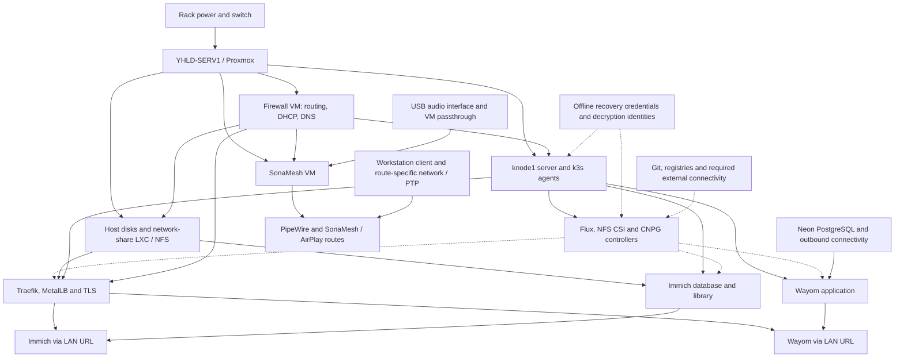

# Homelab recovery map

Start with the failed dependency, then work toward the affected service. This is
an offline, manually maintained map of reviewed configuration. It does not query
hosts, decrypt secrets, or run recovery commands. No restore drill was performed
to produce it. The first version covers the shared foundations and three services:
Immich, Wayom, and SonaMesh. Other applications and public VPS ingress need their
own follow-up entries.

## Find the starting point

| Symptom | Check first | Next section |
| --- | --- | --- |
| Most services and routing are unavailable | Rack power, switch, Proxmox console, firewall VM | [Foundation recovery](#foundation-recovery) |
| Names fail but direct management access works | Firewall DHCP, Unbound, Dnsmasq; distinguish local and upstream resolution | [Foundation recovery](#foundation-recovery) |
| App URLs fail but cluster workloads are healthy | Traefik's NFS volume, ingress node labels, MetalLB, local DNS, TLS | [Ingress](#ingress) |
| Immich cannot mount storage or reach its database | Node storage-network interfaces, NFS exports, original PV/PVC bindings, CNPG | [Immich](#immich) |
| Wayom is unavailable after the cluster recovers | Image pull credentials, application secrets, Neon connectivity, startup migrations | [Wayom](#wayom) |
| Audio is silent while web apps work | Dedicated SonaMesh VM, USB interface, user PipeWire session, route-specific timing/client state | [SonaMesh](#sonamesh) |

## Dependency map

Arrows point from a prerequisite to what needs it. Solid arrows describe runtime
dependencies; dotted arrows describe reconstruction or reconciliation. This is a
curated recovery model, not an extraction of Flux `dependsOn`. A resource being
applied does not prove its storage, network, or application is healthy.

The firewall VM shares the hypervisor's failure domain. SonaMesh has no configured
Kubernetes or NFS dependency in its reviewed host configuration. Wayom's database
is external, but its normal LAN URL still depends on Traefik and Traefik's NFS
certificate volume. [Host inventory][host], [node configuration][nodes],
[ingress volumes][traefik], [Wayom deployment][wayom-deploy], [audio configuration][audio].

## Foundation recovery

This is a proposed order with verification gates. Use it for an outage or an
explicitly arranged drill; do not restart healthy components just to follow the list.
Loss of data requires a restore plan, not merely starting services in order.

| Order | Recover or establish | Gate before continuing | Evidence |
| --- | --- | --- | --- |
| 0 | An independent management path and recovery material | Local console or reachable BMC works without cluster ingress/DNS; required credentials and backup locations are accessible outside the failed host | [BMC inventory][bmc]; independent access remains untested |
| 1 | Rack power, switch and Proxmox | Host storage is present and the guest disks/networks can be inspected from the host console | [Power layout][power], [host inventory][host] |
| 2 | Firewall VM | Management addressing, inter-VLAN routing, DHCP and required local/upstream DNS work | [Firewall DNS][dns], [network inventory][network] |
| 3 | Host data mounts and network-share LXC | Expected files exist in the intended host mounts; NFS exports expose those mounts; a relevant cluster node can reach them | [NFS configuration][nfs], [previous storage incident][immich-incident] |
| 4 | Existing k3s control-plane state, then agents | `knode1` API is available; intended nodes join it; storage-network interfaces work where required | [Node configuration][nodes], [node roles][flake] |
| 5 | Flux access, decryption and platform controllers | Git source fetch works; required decryption identities and substitutions are available; NFS CSI and CNPG are ready for dependent services | [Flux source][flux], [Immich reconciliation][immich-ks] |
| 6 | Service data and application workloads | Verify each service below before reopening its normal access path | Service checklists |
| 7 | LAN ingress and TLS | Correct nodes host Traefik; certificate volume mounts; the advertised address and local DNS reach the intended service | [Ingress checklist](#ingress) |

NFS recovery and control-plane recovery can proceed independently once their own
prerequisites work. Existing workloads need not stop solely because Flux or GitHub
is unavailable. Reconstructing workloads may require Git, chart/image registries,
and credentials that are not needed continuously at runtime.

If `knode1` state is lost, stop at the control-plane restore decision. The reviewed
flake defines one server and three agents; more agents do not provide replacement
control-plane state. The datastore backup location and tested restore procedure
are not established here. Do not initialize a replacement cluster over the original
state. [Node roles][flake], [k3s settings][nodes].

The BMC hostname itself relies on DNS. Keep a separately verified direct console
or management-address procedure available; this map does not establish that path.
The BMC also shares the server's power path. [BMC inventory][bmc], [power layout][power].

## Ingress

The reviewed firewall DNS sends `*.local.yomitosh.media` to the in-cluster MetalLB
address. The older load-balancer LXC remains configured for other backends; starting
it alone does not restore Kubernetes app URLs. [DNS][dns], [migration notes][deferred].

- [ ] Verify Traefik's `traefik-acme` claim is bound and its existing certificate state mounts at `/data`. It uses `nfs-csi-default`; inspect the resolved PV rather than guessing the backing path.
- [ ] Verify eligible ingress nodes are available. The DaemonSet selects `yomitosh.media/ingress=true`; the reviewed flake assigns that label to `knode2` and `knode3`.
- [ ] Verify MetalLB advertisement, the Traefik LoadBalancer service, and local DNS agree. Public VPS access is a separate path, outside this first map.
- [ ] Verify TLS and the intended application response at the LAN hostname. A successful Traefik health check alone is insufficient.
- [ ] If certificates must be issued or renewed, verify Cloudflare DNS-01 credentials and outbound access. Retain existing certificate state when available; it contains private key material and needs protected backup storage.

**Recovery gate:** A client on the intended LAN reaches the correct application
through its hostname with valid TLS. [Traefik volumes][traefik], [PVC][traefik-pvc],
[overlay][traefik-overlay], [node labels][flake].

## Immich

**Needs:** k3s, Flux-managed configuration/secrets, NFS CSI, CNPG, the correct NFS
data directories, and ingress for normal browser access. Its chart also enables
Valkey. Machine-learning cache is disposable; original photos and database state
are not. [Storage overview][immich-readme], [chart overlay][immich-chart].

- [ ] Verify storage-network reachability from the node actually hosting each workload. The previous incident involved missing `eth1` addresses on `knode2` and `knode3`.
- [ ] Verify `${NFS_STORAGE_HOST_FAST}` and the resolved share point at the existing data. Preserve `nfs-csi-immich`, `immich/$${pvc.metadata.name}`, and `Retain` unless executing a separately reviewed data migration.
- [ ] Match the original library and database directories to their PV/PVC bindings. The documented layout uses `immich/immich-data-pvc` and `immich/immich-database-1`. Do not recreate claims merely because pods are pending.
- [ ] Establish database recovery before starting writes. The manifest's `initdb` configuration creates a fresh database; it does not restore historical content. Select a compatible, verified database backup if existing state is lost.
- [ ] Restore or verify the upload library and the read-only external libraries at `NAS-YOM/Picture-Edits` and `NAS-YOM/FTP` against the chosen recovery point.
- [ ] Verify CNPG, Valkey and the Immich server, then inspect a known album and open/download a known original. Check machine learning separately after the core library works.

**Recovery gate:** Existing metadata and original media agree for a recorded sample;
browser access works. A healthy pod with an empty database does not pass.

**Still needed:** A documented database-and-library backup relationship, off-host
backup location, retention, and a completed isolated restore drill. `Retain` protects
against some volume-deletion behavior; it is not a backup. The prior incident is
evidence of a recovery, not a general restore recipe. [StorageClass][immich-sc],
[database bootstrap][immich-db], [incident][immich-incident].

## Wayom

**Needs:** k3s, application configuration and secrets, private GHCR image access
when pulling, outbound Neon connectivity, and ingress for the LAN URL. GitHub OAuth
is needed for login; Lunch Flow is needed for new syncs. Those provider failures
should be distinguished from loss of stored financial data. [Service notes][wayom],
[deployment][wayom-deploy].

- [ ] Verify the intended pinned image is available and `ghcr-pull-secret` permits a pull if required.
- [ ] Verify `wayom-config` and the required keys in `wayom-secrets` are present without printing their values.
- [ ] Confirm the database reference selects the intended Neon project/branch. An empty or development database is not a production recovery.
- [ ] Check database connectivity and startup migration results. Migrations run at application startup, so establish the backup/recovery point before starting a different application version against restored data.
- [ ] Verify the application and ingress, then sign in and compare known accounts and transactions. Test provider sync separately after the stored-data check.

**Recovery gate:** The expected member sees their existing data through the LAN
URL; database/schema failures are absent. A provider outage may still prevent sync.

**Still needed:** A verified Neon recovery window/export strategy and an isolated
restore procedure. The reviewed deployment has no local database PVC or CNPG
dependency. Do not restore an older in-cluster database by default. [Current
reconciliation dependencies][wayom-ks].

## SonaMesh

**Needs:** The dedicated `sonamesh` VM, working network, USB audio interface
passthrough, the lingering `sonamesh` user's PipeWire/WirePlumber session, and the
selected client route. AES67 additionally needs the configured PTP timing path.
The older audio-share LXC is a separate configuration. [VM configuration][audio],
[audio service notes][audio-readme].

- [ ] Verify the VM starts and the BEHRINGER UMC1820 is visible to the guest. Confirm its PipeWire input/output node names match configuration.
- [ ] Verify the lingering user session, PipeWire and WirePlumber before checking route services.
- [ ] Identify the route being tested. The Mac Studio AES67 route uses PTP; the other configured output routes use the earlier transport. Gamebox being offline should not prevent the other routes from recovering.
- [ ] For AES67, verify the PTP interface, clock state, and sender/receiver route settings. For classic AirPlay, verify Avahi discovery and the configured ports. Do not enable NQPTP on the same endpoint: the documented PTP ports are already in use.
- [ ] Verify the workstation's virtual audio device and client. After a deliberate PipeWire restart, follow the linked service note to reconnect SonaMesh clients.
- [ ] Perform a listening check on one output route and a capture check on one input route. Record the route and device used.

**Recovery gate:** The selected client can play and capture audio through the
intended physical channels. Service status and discovery alone do not prove audio.

**Still needed:** An inventory entry for the VM's Proxmox identity and USB passthrough,
a confirmed console/restore path, and the location of recoverable client setup.
Do not copy transient client addresses into this map. The source configuration
remains authoritative for route endpoints.

## Recovery material and unresolved decisions

Record protected storage locations and owners, never credentials themselves.
The entries below are unverified until a person checks the recovery material.

| Material / decision | Why it matters | What is missing |
| --- | --- | --- |
| Management access independent of the firewall VM | The firewall cannot help reach its own failed hypervisor | Tested console/BMC path and offline instructions |
| Proxmox guest definitions, disks and host data mounts | Nix and Kubernetes manifests do not reconstruct every host disk or passthrough mapping | Backup location, last successful restore, boot ordering |
| k3s datastore and required token/decryption identities | One server is configured; agents cannot supply its lost state | Off-host copies and a tested restore procedure |
| Node decryption identity and Flux `sops-age` recovery | Encrypted configuration is insufficient without the corresponding keys | Verified escrow locations outside this host; these are distinct uses, not assumed interchangeable keys |
| Git/registry access and required images | A clean reconstruction cannot rely on already-cached artifacts | Recovery credentials and offline artifact expectations |
| Immich database, originals and external libraries | All must agree at the selected recovery point | Backup schedule, retention and drill evidence |
| Neon data recovery | Wayom's database is outside the homelab | Provider recovery entitlement/window and verified export or restore |
| Traefik certificate state and DNS-01 access | LAN HTTPS recovery depends on storage and possibly reissuance | Protected backup and renewal verification |
| SonaMesh VM, USB mapping and client configuration | Audio recovery crosses host, guest and workstation state | Physical mapping and route-specific drill |

Recovery-time and acceptable-data-loss targets have not been agreed. For the first
drill, choose one service, restore into isolation, and record the source revision,
backup timestamp, elapsed time, validation sample, and remaining failures. Do not
mark a row verified from a successful configuration build alone.

## Sources and maintenance

Reviewed on 2026-09-18 against these revisions of `main`. These are configuration
snapshots, not proof that the running systems match them. Evidence links are pinned
so a future configuration change cannot silently change the basis of this map.

| Repository | Revision | Responsibility |
| --- | --- | --- |
| homelab | `929207677f4f0c011a37dc8d87b84e2592024ea1` | Physical inventory and prior architecture notes |
| nix-dotfiles | `c7805b708d99b0cdf0df2464476ed3cdb25c9ed8` | Host, network, NFS and SonaMesh configuration |
| home-ops | `c5833aed11c942d8e46e17a191f61dead5b7c077` | Flux, ingress, workload and storage configuration |

Update this document when a service changes host, database, storage path, ingress,
or secret-recovery mechanism. Recheck the relevant source files, update their pinned
revision and the table, then revise both the diagram and checklist. Record actual
drill results in dated operation notes and link them here. Keep machine configuration
in its owning repository; this document owns the cross-repository recovery explanation.

The host inventory still describes the older audio-share LXC and load-balancer
role. The current configuration adds the dedicated audio VM and in-cluster ingress.
This map records that distinction without assuming the older services were removed.

[host]: ./devices/YHLD-SERV1/YHLD-SERV1.md
[bmc]: ./devices/YHLD-IPMI1.md
[power]: ./POWER.md
[network]: ./NETWORKING.md
[nodes]: https://github.com/abayomi185/nix-dotfiles/blob/c7805b708d99b0cdf0df2464476ed3cdb25c9ed8/hosts/knode/configuration.nix
[flake]: https://github.com/abayomi185/nix-dotfiles/blob/c7805b708d99b0cdf0df2464476ed3cdb25c9ed8/flake.nix
[dns]: https://github.com/abayomi185/nix-dotfiles/blob/c7805b708d99b0cdf0df2464476ed3cdb25c9ed8/hosts/firewall/dns.nix
[nfs]: https://github.com/abayomi185/nix-dotfiles/blob/c7805b708d99b0cdf0df2464476ed3cdb25c9ed8/hosts/lxc/network-share/configuration.nix
[audio]: https://github.com/abayomi185/nix-dotfiles/blob/c7805b708d99b0cdf0df2464476ed3cdb25c9ed8/hosts/sonamesh/configuration.nix
[audio-readme]: https://github.com/abayomi185/nix-dotfiles/blob/c7805b708d99b0cdf0df2464476ed3cdb25c9ed8/hosts/sonamesh/README.md
[flux]: https://github.com/abayomi185/home-ops/blob/c5833aed11c942d8e46e17a191f61dead5b7c077/clusters/homelab/flux/flux-system/gotk-sync.yaml
[traefik]: https://github.com/abayomi185/home-ops/blob/c5833aed11c942d8e46e17a191f61dead5b7c077/apps/base/network-system/traefik/deployment.yaml
[traefik-pvc]: https://github.com/abayomi185/home-ops/blob/c5833aed11c942d8e46e17a191f61dead5b7c077/apps/base/network-system/traefik/pvc.yaml
[traefik-overlay]: https://github.com/abayomi185/home-ops/blob/c5833aed11c942d8e46e17a191f61dead5b7c077/apps/production/network-system/traefik/patch_deployment.yaml
[deferred]: https://github.com/abayomi185/home-ops/blob/c5833aed11c942d8e46e17a191f61dead5b7c077/docs/deferred-items.md
[immich-readme]: https://github.com/abayomi185/home-ops/blob/c5833aed11c942d8e46e17a191f61dead5b7c077/apps/production/media/immich/README.md
[immich-chart]: https://github.com/abayomi185/home-ops/blob/c5833aed11c942d8e46e17a191f61dead5b7c077/apps/production/media/immich/patch_helm-release.yaml
[immich-ks]: https://github.com/abayomi185/home-ops/blob/c5833aed11c942d8e46e17a191f61dead5b7c077/apps/production/media/immich/ks.yaml
[immich-sc]: https://github.com/abayomi185/home-ops/blob/c5833aed11c942d8e46e17a191f61dead5b7c077/apps/production/media/immich/sc.yaml
[immich-db]: https://github.com/abayomi185/home-ops/blob/c5833aed11c942d8e46e17a191f61dead5b7c077/apps/base/media/immich/database.yaml
[immich-incident]: https://github.com/abayomi185/home-ops/blob/c5833aed11c942d8e46e17a191f61dead5b7c077/docs/operations/2026-06-12-immich-storage-recovery.md
[wayom]: https://github.com/abayomi185/home-ops/blob/c5833aed11c942d8e46e17a191f61dead5b7c077/apps/production/productivity/wayom/README.md
[wayom-deploy]: https://github.com/abayomi185/home-ops/blob/c5833aed11c942d8e46e17a191f61dead5b7c077/apps/base/productivity/wayom/deployment.yaml
[wayom-ks]: https://github.com/abayomi185/home-ops/blob/c5833aed11c942d8e46e17a191f61dead5b7c077/apps/production/productivity/wayom/ks.yaml
